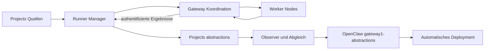

# Gateway 1 — OpenClaw Workspace

Workspace des ersten OpenClaw AI Gateways im Clusterverbund.
Dieser Branch wird automatisch 2× täglich synchronisiert (`auto: gateway-sync`).

## Worker- und Relay-Nodes

Gateway 1 kann folgende Nodes als Worker/Relay verwenden — je nach
Verfügbarkeit, Erreichbarkeit und Priorität (Tailscale VPN / Fallback WireGuard):

| Node | Kapazität | Typ | Anmerkung |
| --- | --- | --- | --- |
| node2 | medium | Server | Stabil, Fallback |
| node3 | medium | Server | Bedingt verfügbar |
| node5 | low | Redmi Note 11S | Mobile, wenn online |
| node7 | high | Server | Docker, schwere Jobs |
| node4, node6, node8 | — | — | Je nach Konfiguration |

Docker-Container auf den Nodes werden für rechenintensive Jobs verwendet.

## Workspace-Inhalte

| Verzeichnis / Datei | Beschreibung |
| --- | --- |
| `scripts/` | Ausführbare Scripts des Gateways |
| `skills/` | ClawHub Skills (veröffentlichte Abstraktionen) |
| `abstraction-manager/` | Abstraction-Manager-Konfiguration |
| `cron/` | Geplante Aufgaben (Heartbeat, Sync, …) |
| `logs/` | Gateway-Logs |
| `docs/` | Lokale Dokumentation |
| `MEMORY.md` | Persistentes Gateway-Gedächtnis |
| `SOUL.md` | Gateway-Identität und Verhalten |
| `AGENTS.md` | Konfigurierte Sub-Agents |
| `TOOLS.md` | Verfügbare Tools |
| `SYNC-SYSTEM.md` | Beschreibung der Sync-Mechanik |

## Verfügbare Skills

`cluster-gateway` · `cluster-management` · `coding-agent` · `db-maintainer` ·
`doc-scraper` · `documentation` · `git-publish-agent` · `json-utils` ·
`log-collector` · `mcp-tool-utils` · `model-usage` · `multi-nodes-utils` ·
`relay-node` · `reports-creator` · `resource-manager` ·
`script-abstractions-manager` · `scripting-utils` · `server-maintenance` ·
`sherpa-onnx-tts` · `spotify-player` · `sub-agents-utils` · `tiktok-live-mon` ·
`web-scraper` · `worker-node` · `workspace-db`

## Script-Abstraktionen

→ Branch [`gateway1-abstractions`](../../tree/gateway1-abstractions)

## Repositories und Architektur

- [OpenClaw `gateway1`](https://github.com/KikiKari/OpenClaw/tree/gateway1): Gateway, Manager und Entwicklungsstand.
- [OpenClaw `gateway1-abstractions`](https://github.com/KikiKari/OpenClaw/tree/gateway1-abstractions): versionierter Ausgabepool und Quelle des [Katalogs](https://abstractions-two.vercel.app/).
- [Projects `abstractions`](https://github.com/KikiKari/Projects/tree/abstractions): zusätzliche Arbeits- und Veröffentlichungsfläche; ihre Übersetzungen werden zusätzlich im OpenClaw-Pool konsolidiert.

Die [interaktive 3D-Architektur](https://abstractions-two.vercel.app/3d.html), die [Mermaid-Abläufe](https://github.com/KikiKari/Projects/tree/abstractions#abläufe), das [Architektur-GIF](https://github.com/KikiKari/Projects/raw/refs/heads/abstractions/docs/assets/architektur-rotation.gif) und die [isometrische Grafik](https://github.com/KikiKari/Projects/raw/refs/heads/abstractions/docs/assets/architektur-iso.png) gehören zur Dokumentation.

## Aktueller Arbeitsstand

Die [Sprachtabelle](https://github.com/KikiKari/OpenClaw/tree/gateway1-abstractions#aktueller-arbeitsstand) zählt versionierte Dateien automatisch. Details zu Läufen: [STATUS.md](https://github.com/KikiKari/OpenClaw/blob/gateway1-abstractions/STATUS.md).

## Abstraction Manager: Betrieb und Entwicklungsstand

Der Manager unterstützt 16 Zielsprachen: JavaScript, Perl 5, PowerShell, Python, Shell, Tcl, Raku, Ruby, Lua, Go, Java, C, C++, PHP, F# und CSS. Alle Projects-Branches dienen als Quellen; CSS berücksichtigt HTML mit vorhandenen Stilen.

Übersetzungsaufträge verwenden über OpenRouter die Kette `qwen/qwen3-coder`, `deepseek/deepseek-chat-v3.1`, `z-ai/glm-4.6`, `mistralai/codestral-2508` und `qwen/qwen-2.5-coder-32b-instruct`. `ABSTRACTIONS_MODELL` ersetzt die Auswahl bei Bedarf. Der Schlüssel wird aus der Laufzeitumgebung gelesen.

`OpenClaw@gateway1` enthält Gateway-Manager und Transport. `Projects@abstractions` ist zusätzliche Arbeits- und Veröffentlichungsfläche; fehlende Übersetzungsinhalte werden einseitig unter Erhalt von Varianten nach `OpenClaw@gateway1-abstractions` übernommen. Der eigenständige Container arbeitet im Zwölf-Stunden-Takt, der Gateway-Manager im Sechs-Stunden-Takt und der Observer-Cron im Drei-Stunden-Takt.

Der [Projects-Workflow auf main](https://github.com/KikiKari/Projects/blob/main/.github/workflows/abstraktionen.yml) verwendet den neuen Runner-Manager. Ein produktiver Gesamtlauf mit Node-Ausführung und authentifizierter Rückgabe ist noch nachzuweisen. Ein manueller Gateway-Observer-Lauf ist abgeschlossen und in der Datenbank erfasst. [0PE-265](https://linear.app/0penclaw/issue/0PE-265), [0PE-266](https://linear.app/0penclaw/issue/0PE-266), [0PE-267](https://linear.app/0penclaw/issue/0PE-267), [0PE-274](https://linear.app/0penclaw/issue/0PE-274) und [0PE-277](https://linear.app/0penclaw/issue/0PE-277) dokumentieren Aufgaben und Nachweise.

Der [aktuelle Arbeitsstand](https://github.com/KikiKari/OpenClaw/tree/gateway1-abstractions#aktueller-arbeitsstand) zählt versionierte Dateien automatisch; [STATUS.md](https://github.com/KikiKari/OpenClaw/blob/gateway1-abstractions/STATUS.md) enthält Laufdetails. Bestehende Mermaid-Abläufe, Three.js-Ansicht, Grafiken und Generatoren bleiben erhalten.

## Quellenindex und Observer

Der Manager verarbeitet Quellen aus den konfigurierten Repositories einschließlich aller Projects-Branches für 16 Zielsprachen. Projects@abstractions ist eine zusätzliche Arbeits- und Veröffentlichungsfläche; OpenClaw@gateway1 enthält den Gateway-Manager und OpenClaw@gateway1-abstractions den veröffentlichten Katalog. Der einseitige Abgleich ergänzt fehlende Projects-Übersetzungen im OpenClaw-Ausgabezweig und erhält Varianten, Mermaid, Three.js, Ansichten, Grafiken und Generatoren.

Der Projects-Runner stellt einen commitgebundenen Quellenindex als Actions-Artefakt bereit. Der Observer aktualisiert seinen Index im Drei-Stunden-Takt und vergleicht Repository, Branch und Commit; abweichende Commits bleiben getrennt. Der Manager verwendet indizierte Checkouts mit 1.800 Sekunden Zeitlimit und bricht bei fehlgeschlagenem Spiegelabgleich ab.

Observer-Befunde aus Actions, Vercel und Anbieterantworten werden projektbezogenen Linear-Issues zugeordnet; kritische Befunde können Projektaktivitäten erzeugen. Issue-Benachrichtigungen an Slack sind belegt. Der produktive Projects-Lauf mit Node-Ausführung, authentifizierter Rückgabe und Indexabgleich wird gesondert nachgewiesen. Laufzeit-Secrets stammen aus bestehenden Umgebungen.

Weiterführend: [0PE-265](https://linear.app/0penclaw/issue/0PE-265), [0PE-267](https://linear.app/0penclaw/issue/0PE-267), [0PE-277](https://linear.app/0penclaw/issue/0PE-277), [0PE-278](https://linear.app/0penclaw/issue/0PE-278).

## Abstraction Manager: Entwicklungs- und Betriebsstand (24.11.2026)

Die Arbeiten [0PE-265](https://linear.app/0penclaw/issue/0PE-265), [0PE-267](https://linear.app/0penclaw/issue/0PE-267), [0PE-277](https://linear.app/0penclaw/issue/0PE-277) und [0PE-278](https://linear.app/0penclaw/issue/0PE-278) verbinden die Spracherweiterung mit Projects, Gateway-Nodes und dem unabhängigen Observer. Der Runner erstellt einen commitgebundenen Quellenindex und Gateway-Auftrag; das Gateway verteilt Teilaufträge und der Runner prüft authentifizierte Ergebnisse. Die Modellkette über OpenRouter umfasst qwen/qwen3-coder, deepseek/deepseek-chat-v3.1, z-ai/glm-4.6, mistralai/codestral-2508 und qwen/qwen-2.5-coder-32b-instruct; `ABSTRACTIONS_MODELL` kann die Auswahl ersetzen.

Der Observer läuft über Cron und erfasst Lauf-, Node-, Dependabot- und Anbieterzustände einschließlich Transport-, Rate-, Nutzungs- und Billing-Grenzen. Befunde werden projektbezogen priorisiert und mit bestehenden Linear-Issues einschließlich abgeschlossener und duplizierter Einträge abgeglichen; 0PE-277 bleibt das Entwicklungsissue. Projekt-Activity kann über bestehende Linear-Slack-Verknüpfungen weitergeleitet werden. Die konkrete Zustellung ist je Projekt zu belegen.

**Nachweisstand:** [Projects-Lauf 388](https://github.com/KikiKari/Projects/actions/runs/45316876792) erstellte beide Artefakte, erreichte aber keinen vollständig bestätigten Rücktransport. Der [nachfolgende Lauf](https://github.com/KikiKari/Projects/actions/runs/45367050896) verarbeitet Teilaufträge; ein Node-Auftrag meldete `provider_invalid_response`. Linear lehnte die neue Issue-Anlage wegen der kostenlosen Issue-Grenze ab. Ein vollständiger produktiver Durchlauf mit authentifizierter Rückgabe bleibt nachzuweisen.

[Vercel](https://vercel.com/openclaw-vercel-project): Das Projekt `abstractions` zeigt Produktions-Deployments von `gateway1-abstractions` und Preview-Deployments von `main` und `gateway1`; der aktuelle Zustand ist jeweils am Deployment zu prüfen. Weitere Einzelheiten stehen in der [Abstraction-Manager-Dokumentation](https://app.notion.com/p/4168d8ad3db981cd9ab4e7935df22343).

## Abstraction Manager – Betriebswege

[Projects@abstractions](https://github.com/KikiKari/Projects/tree/abstractions) ist Arbeits- und zusätzliche Veröffentlichungsfläche. [OpenClaw@gateway1](https://github.com/KikiKari/OpenClaw/tree/gateway1) enthält Gateway-Manager und Komponenten. [OpenClaw@gateway1-abstractions](https://github.com/KikiKari/OpenClaw/tree/gateway1-abstractions) ist Ausgabe- und Katalogpool. Der Observer übernimmt fehlende Projects-Übersetzungen einseitig in den Pool, dedupliziert identische Inhalte und erhält abweichende Varianten. Eine Rücksynchronisierung nach Projects findet nicht statt; Mermaid, Three.js, Ansichten, Grafiken und Generatoren in Projects bleiben erhalten.

Der Projects-Workflow auf main läuft alle sechs Stunden oder manuell. Er stellt Quellenindex und Gateway-Auftrag bereit; OpenClaw-Nodes bearbeiten zugewiesene Teilaufträge, deren authentifizierte Rückgabe vor Veröffentlichung geprüft wird. Der unabhängige lokale Docker-Container arbeitet in seinem eigenen Zwölf-Stunden-Takt. Die 16 Zielsprachen umfassen JavaScript, Perl 5, PowerShell, Python, Shell, Tcl, Raku, Ruby, Lua, Go, Java, C, C++, PHP, F# und CSS.

Der getrennte Observer wird alle drei Stunden aufgerufen und ordnet GitHub-Actions-, Vercel-, Index- und Batchzustände nach Lauf, Commit, Repository und Projekt zu. Er berücksichtigt Dependabot, API-Transport, Berechtigungen, Rate- und Nutzungslimits, Billing und einen erweiterbaren Fehlerkatalog. Linear-Issues werden projektbezogen dedupliziert und priorisiert; 0PE-277 bleibt Entwicklungsissue. Projektaktivitäten können über konfigurierte Linear-Slack-Verknüpfungen zugestellt werden. Der lokale Poolabgleich ist nach Erfolg für drei Stunden und nach Fehler für fünf Minuten vorgesehen; laufende Prozesse verwenden ihre geladene Fassung.

Checkout mit isoliertem Git-Index und exakten Dateinamen hat ein Limit von 3.000 Sekunden. Der aktuelle Workflow begrenzt den Ergebnisempfang anhand der verbleibenden Jobzeit und meldet seinen Wartestatus. Ein Abgleich ohne neue Inhalte erzeugt keinen neuen Commit. Lauf, Artefakte, Node-Ausführung, authentifizierte Rückgabe und Veröffentlichung werden getrennt nachgewiesen. Weiterführende Aufgaben: [0PE-263](https://linear.app/0penclaw/issue/0PE-263), [0PE-265](https://linear.app/0penclaw/issue/0PE-265), [0PE-267](https://linear.app/0penclaw/issue/0PE-267), [0PE-277](https://linear.app/0penclaw/issue/0PE-277), [0PE-278](https://linear.app/0penclaw/issue/0PE-278).

## Observer: Triage und Wiederaufnahme

Der Gateway-Observer bündelt die Befunde eines Laufs in einer dauerhaften Outbox und erstellt pro Lauf mit Befunden ein priorisiertes Linear-Triage-Issue. Offene Zusammenfassungen werden bei späteren Läufen erneut übertragen und anhand einer stabilen Kennung sowie bestätigter Rücklesung abgeglichen. Erst danach können identische, unveränderte Kopien ohne zusätzliche Bearbeitungsmetadaten automatisch archiviert werden. Abweichende und lediglich ähnliche Issues bleiben bestehen.

Qualitäts-, Sicherheits- und weitere Einzelbefunde werden zusätzlich wiederaufnehmbar und priorisiert bestehenden oder neuen Issues im zuständigen Projekt zugeordnet; wiederholte Workflow-Abbrüche bleiben in der Sammeltriage. Der Fehlerkatalog stellt Bewertungs- und Handlungsoptionen bereit. Automatische Korrekturen und Ausschlüsse sind durch diese Zuordnung allein noch nicht nachgewiesen. Laufbefunde und der aktuelle Arbeitsstand stehen in [0PE-277](https://linear.app/0penclaw/issue/0PE-277).
