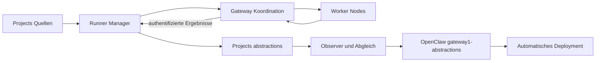

# Gateway 1 — Script Abstractions

Modellgenerierte und syntaktisch geprüfte Portierungen aus den konfigurierten
OpenClaw-, Projects- und Onboarding-Quellen. Der Abstraction Manager führt den
Bestand alle sechs Stunden fort und veröffentlicht direkt in diesem Branch.

## Aktueller Arbeitsstand

Die Tabelle wird aus den versionierten Dateien automatisch aktualisiert. Details zu den Läufen stehen in [STATUS.md](STATUS.md).

| Sprache | Aktive Dateien | Verzeichnis |
| --- | ---: | --- |
| JavaScript | 1964 | `javascript/` |
| Perl 5 | 2143 | `perl5/` |
| PowerShell | 2099 | `powershell/` |
| Python | 2093 | `python/` |
| Shell | 1451 | `shell/` |
| Tcl | 2322 | `tcl/` |
| Raku | 119 | `perl6/` |
| Ruby | 424 | `ruby/` |
| Lua | 421 | `lua/` |
| Go | 265 | `go/` |
| Java | 40 | `java/` |
| C | 31 | `c/` |
| C++ | 28 | `cpp/` |
| PHP | 41 | `php/` |
| F# | 36 | `fsharp/` |
| CSS | 1 | `css/` |
| **Gesamt** | **13478** | |

## Vercel-Preview

Die [Gateway-1-Preview](https://openclaw-git-gateway1-abstractions-openclaw-vercel-project.vercel.app) zeigt den aktiven Bestand mit Sprachfilter, Dateisuche und Quelltextansicht. Die Dateien werden als Text angezeigt und nicht ausgeführt. Das historische Verzeichnis ist vom Katalog ausgeschlossen.

Der Build erfasst die vorhandenen Sprachverzeichnisse und erzeugt `dist/catalog.json.gz`. Neue Dateien erscheinen nach dem nächsten erfolgreichen Build. Der Katalog enthält den vollständigen Quelltext und wird beim Öffnen der Preview geladen; seine Größe kann die Ladezeit beeinflussen.

Lokaler Build mit installiertem Node.js und npm:

```sh
npm ci
npm run build
```

Das Ergebnis liegt in `dist/`. Die Versionen der npm-Abhängigkeiten sind in `package-lock.json` festgehalten.

## Veröffentlichung

Der Manager legt angenommene Ergebnisse in den Sprachverzeichnissen ab. Der Publisher veröffentlicht vorgemerkte Ergebnisse nach `gateway1-abstractions`. `STATUS.md` beschreibt den zuletzt dokumentierten Lauf; die Tabelle oben zählt versionierte Dateien und wird unabhängig davon aktualisiert.

## Repositories und Architektur

- [OpenClaw `gateway1`](https://github.com/KikiKari/OpenClaw/tree/gateway1): Gateway, Manager und Entwicklungsstand.
- [OpenClaw `gateway1-abstractions`](https://github.com/KikiKari/OpenClaw/tree/gateway1-abstractions): versionierter Ausgabepool und Quelle des [Katalogs](https://abstractions-two.vercel.app/).
- [Projects `abstractions`](https://github.com/KikiKari/Projects/tree/abstractions): zusätzliche Arbeits- und Veröffentlichungsfläche; ihre Übersetzungen werden zusätzlich im OpenClaw-Pool konsolidiert.

Die [interaktive 3D-Architektur](https://abstractions-two.vercel.app/3d.html), die [Mermaid-Abläufe](https://github.com/KikiKari/Projects/tree/abstractions#abläufe), das [Architektur-GIF](https://github.com/KikiKari/Projects/raw/refs/heads/abstractions/docs/assets/architektur-rotation.gif) und die [isometrische Grafik](https://github.com/KikiKari/Projects/raw/refs/heads/abstractions/docs/assets/architektur-iso.png) gehören zur Dokumentation.

## Abstraction Manager: Betrieb und Entwicklungsstand

Der Manager unterstützt 16 Zielsprachen: JavaScript, Perl 5, PowerShell, Python, Shell, Tcl, Raku, Ruby, Lua, Go, Java, C, C++, PHP, F# und CSS. Alle Projects-Branches dienen als Quellen; CSS berücksichtigt HTML mit vorhandenen Stilen.

Übersetzungsaufträge verwenden über OpenRouter die Kette `qwen/qwen3-coder`, `deepseek/deepseek-chat-v3.1`, `z-ai/glm-4.6`, `mistralai/codestral-2508` und `qwen/qwen-2.5-coder-32b-instruct`. `ABSTRACTIONS_MODELL` ersetzt die Auswahl bei Bedarf. Der Schlüssel wird aus der Laufzeitumgebung gelesen.

`OpenClaw@gateway1` enthält Gateway-Manager und Transport. `Projects@abstractions` ist zusätzliche Arbeits- und Veröffentlichungsfläche; fehlende Übersetzungsinhalte werden einseitig unter Erhalt von Varianten nach `OpenClaw@gateway1-abstractions` übernommen. Der eigenständige Container arbeitet im Zwölf-Stunden-Takt, der Gateway-Manager im Sechs-Stunden-Takt und der Observer-Cron im Drei-Stunden-Takt.



Der [Projects-Workflow auf main](https://github.com/KikiKari/Projects/blob/main/.github/workflows/abstraktionen.yml) verwendet den neuen Runner-Manager. Ein produktiver Gesamtlauf mit Node-Ausführung und authentifizierter Rückgabe ist noch nachzuweisen. Ein manueller Gateway-Observer-Lauf ist abgeschlossen und in der Datenbank erfasst. [0PE-265](https://linear.app/0penclaw/issue/0PE-265), [0PE-266](https://linear.app/0penclaw/issue/0PE-266), [0PE-267](https://linear.app/0penclaw/issue/0PE-267), [0PE-274](https://linear.app/0penclaw/issue/0PE-274) und [0PE-277](https://linear.app/0penclaw/issue/0PE-277) dokumentieren Aufgaben und Nachweise.

Der [aktuelle Arbeitsstand](https://github.com/KikiKari/OpenClaw/tree/gateway1-abstractions#aktueller-arbeitsstand) zählt versionierte Dateien automatisch; [STATUS.md](https://github.com/KikiKari/OpenClaw/blob/gateway1-abstractions/STATUS.md) enthält Laufdetails. Bestehende Mermaid-Abläufe, Three.js-Ansicht, Grafiken und Generatoren bleiben erhalten.


## Quellenindex und Observer

Der Manager verarbeitet Quellen aus den konfigurierten Repositories einschließlich aller Projects-Branches für 16 Zielsprachen. Projects@abstractions ist eine zusätzliche Arbeits- und Veröffentlichungsfläche; OpenClaw@gateway1 enthält den Gateway-Manager und OpenClaw@gateway1-abstractions den veröffentlichten Katalog. Der einseitige Abgleich ergänzt fehlende Projects-Übersetzungen im OpenClaw-Ausgabezweig und erhält Varianten, Mermaid, Three.js, Ansichten, Grafiken und Generatoren.

Der Projects-Runner stellt einen commitgebundenen Quellenindex als Actions-Artefakt bereit. Der Observer aktualisiert seinen Index im Drei-Stunden-Takt und vergleicht Repository, Branch und Commit; abweichende Commits bleiben getrennt. Der Manager verwendet indizierte Checkouts mit 1.800 Sekunden Zeitlimit und bricht bei fehlgeschlagenem Spiegelabgleich ab.

Observer-Befunde aus Actions, Vercel und Anbieterantworten werden projektbezogenen Linear-Issues zugeordnet; kritische Befunde können Projektaktivitäten erzeugen. Issue-Benachrichtigungen an Slack sind belegt. Der produktive Projects-Lauf mit Node-Ausführung, authentifizierter Rückgabe und Indexabgleich wird gesondert nachgewiesen. Laufzeit-Secrets stammen aus bestehenden Umgebungen.

Weiterführend: [0PE-265](https://linear.app/0penclaw/issue/0PE-265), [0PE-267](https://linear.app/0penclaw/issue/0PE-267), [0PE-277](https://linear.app/0penclaw/issue/0PE-277), [0PE-278](https://linear.app/0penclaw/issue/0PE-278).
