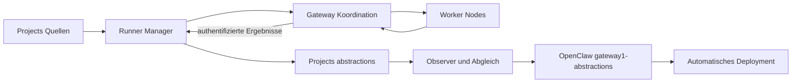

# Gateway 1 — OpenClaw Workspace

Workspace des ersten OpenClaw AI Gateways im Clusterverbund.
Dieser Branch wird automatisch 2× täglich synchronisiert (`auto: gateway-sync`).

## Worker- und Relay-Nodes

Gateway 1 kann folgende Nodes als Worker/Relay verwenden — je nach
Verfügbarkeit, Erreichbarkeit und Priorität (Tailscale VPN / Fallback WireGuard):

| Node | Kapazität | Typ | Anmerkung |
| --- | --- | --- | --- |
| node2 | medium | Server | Stabil, Fallback |
| node3 | medium | Server | Bedingt verfügbar |
| node5 | low | Redmi Note 11S | Mobile, wenn online |
| node7 | high | Server | Docker, schwere Jobs |
| node4, node6, node8 | — | — | Je nach Konfiguration |

Docker-Container auf den Nodes werden für rechenintensive Jobs verwendet.

## Workspace-Inhalte

| Verzeichnis / Datei | Beschreibung |
| --- | --- |
| `scripts/` | Ausführbare Scripts des Gateways |
| `skills/` | ClawHub Skills (veröffentlichte Abstraktionen) |
| `abstraction-manager/` | Abstraction-Manager-Konfiguration |
| `cron/` | Geplante Aufgaben (Heartbeat, Sync, …) |
| `logs/` | Gateway-Logs |
| `docs/` | Lokale Dokumentation |
| `MEMORY.md` | Persistentes Gateway-Gedächtnis |
| `SOUL.md` | Gateway-Identität und Verhalten |
| `AGENTS.md` | Konfigurierte Sub-Agents |
| `TOOLS.md` | Verfügbare Tools |
| `SYNC-SYSTEM.md` | Beschreibung der Sync-Mechanik |

## Verfügbare Skills

`cluster-gateway` · `cluster-management` · `coding-agent` · `db-maintainer` ·
`doc-scraper` · `documentation` · `git-publish-agent` · `json-utils` ·
`log-collector` · `mcp-tool-utils` · `model-usage` · `multi-nodes-utils` ·
`relay-node` · `reports-creator` · `resource-manager` ·
`script-abstractions-manager` · `scripting-utils` · `server-maintenance` ·
`sherpa-onnx-tts` · `spotify-player` · `sub-agents-utils` · `tiktok-live-mon` ·
`web-scraper` · `worker-node` · `workspace-db`

## Script-Abstraktionen

→ Branch [`gateway1-abstractions`](../../tree/gateway1-abstractions)

## Repositories und Architektur

- [OpenClaw `gateway1`](https://github.com/KikiKari/OpenClaw/tree/gateway1): Gateway, Manager und Entwicklungsstand.
- [OpenClaw `gateway1-abstractions`](https://github.com/KikiKari/OpenClaw/tree/gateway1-abstractions): versionierter Ausgabepool und Quelle des [Katalogs](https://abstractions-two.vercel.app/).
- [Projects `abstractions`](https://github.com/KikiKari/Projects/tree/abstractions): zusätzliche Arbeits- und Veröffentlichungsfläche; ihre Übersetzungen werden zusätzlich im OpenClaw-Pool konsolidiert.

Die [interaktive 3D-Architektur](https://abstractions-two.vercel.app/3d.html), die [Mermaid-Abläufe](https://github.com/KikiKari/Projects/tree/abstractions#abläufe), das [Architektur-GIF](https://github.com/KikiKari/Projects/raw/refs/heads/abstractions/docs/assets/architektur-rotation.gif) und die [isometrische Grafik](https://github.com/KikiKari/Projects/raw/refs/heads/abstractions/docs/assets/architektur-iso.png) gehören zur Dokumentation.

## Aktueller Arbeitsstand

Die [Sprachtabelle](https://github.com/KikiKari/OpenClaw/tree/gateway1-abstractions#aktueller-arbeitsstand) zählt versionierte Dateien automatisch. Details zu Läufen: [STATUS.md](https://github.com/KikiKari/OpenClaw/blob/gateway1-abstractions/STATUS.md).

## Abstraction Manager: Betrieb und Entwicklungsstand

Der Manager unterstützt 16 Zielsprachen: JavaScript, Perl 5, PowerShell, Python, Shell, Tcl, Raku, Ruby, Lua, Go, Java, C, C++, PHP, F# und CSS. Alle Projects-Branches dienen als Quellen; CSS berücksichtigt HTML mit vorhandenen Stilen.

Übersetzungsaufträge verwenden über OpenRouter die Kette `qwen/qwen3-coder`, `deepseek/deepseek-chat-v3.1`, `z-ai/glm-4.6`, `mistralai/codestral-2508` und `qwen/qwen-2.5-coder-32b-instruct`. `ABSTRACTIONS_MODELL` ersetzt die Auswahl bei Bedarf. Der Schlüssel wird aus der Laufzeitumgebung gelesen.

`OpenClaw@gateway1` enthält Gateway-Manager und Transport. `Projects@abstractions` ist zusätzliche Arbeits- und Veröffentlichungsfläche; fehlende Übersetzungsinhalte werden einseitig unter Erhalt von Varianten nach `OpenClaw@gateway1-abstractions` übernommen. Der eigenständige Container arbeitet im Zwölf-Stunden-Takt, der Gateway-Manager im Sechs-Stunden-Takt und der Observer-Cron im Drei-Stunden-Takt.

Der [Projects-Workflow auf main](https://github.com/KikiKari/Projects/blob/main/.github/workflows/abstraktionen.yml) verwendet den neuen Runner-Manager. Ein produktiver Gesamtlauf mit Node-Ausführung und authentifizierter Rückgabe ist noch nachzuweisen. Ein manueller Gateway-Observer-Lauf ist abgeschlossen und in der Datenbank erfasst. [0PE-265](https://linear.app/0penclaw/issue/0PE-265), [0PE-266](https://linear.app/0penclaw/issue/0PE-266), [0PE-267](https://linear.app/0penclaw/issue/0PE-267), [0PE-274](https://linear.app/0penclaw/issue/0PE-274) und [0PE-277](https://linear.app/0penclaw/issue/0PE-277) dokumentieren Aufgaben und Nachweise.

Der [aktuelle Arbeitsstand](https://github.com/KikiKari/OpenClaw/tree/gateway1-abstractions#aktueller-arbeitsstand) zählt versionierte Dateien automatisch; [STATUS.md](https://github.com/KikiKari/OpenClaw/blob/gateway1-abstractions/STATUS.md) enthält Laufdetails. Bestehende Mermaid-Abläufe, Three.js-Ansicht, Grafiken und Generatoren bleiben erhalten.

## Quellenindex und Observer

Der Manager verarbeitet Quellen aus den konfigurierten Repositories einschließlich aller Projects-Branches für 16 Zielsprachen. Projects@abstractions ist eine zusätzliche Arbeits- und Veröffentlichungsfläche; OpenClaw@gateway1 enthält den Gateway-Manager und OpenClaw@gateway1-abstractions den veröffentlichten Katalog. Der einseitige Abgleich ergänzt fehlende Projects-Übersetzungen im OpenClaw-Ausgabezweig und erhält Varianten, Mermaid, Three.js, Ansichten, Grafiken und Generatoren.

Der Projects-Runner stellt einen commitgebundenen Quellenindex als Actions-Artefakt bereit. Der Observer aktualisiert seinen Index im Drei-Stunden-Takt und vergleicht Repository, Branch und Commit; abweichende Commits bleiben getrennt. Der Manager verwendet indizierte Checkouts mit 1.800 Sekunden Zeitlimit und bricht bei fehlgeschlagenem Spiegelabgleich ab.

Observer-Befunde aus Actions, Vercel und Anbieterantworten werden projektbezogenen Linear-Issues zugeordnet; kritische Befunde können Projektaktivitäten erzeugen. Issue-Benachrichtigungen an Slack sind belegt. Der produktive Projects-Lauf mit Node-Ausführung, authentifizierter Rückgabe und Indexabgleich wird gesondert nachgewiesen. Laufzeit-Secrets stammen aus bestehenden Umgebungen.

Weiterführend: [0PE-265](https://linear.app/0penclaw/issue/0PE-265), [0PE-267](https://linear.app/0penclaw/issue/0PE-267), [0PE-277](https://linear.app/0penclaw/issue/0PE-277), [0PE-278](https://linear.app/0penclaw/issue/0PE-278).
